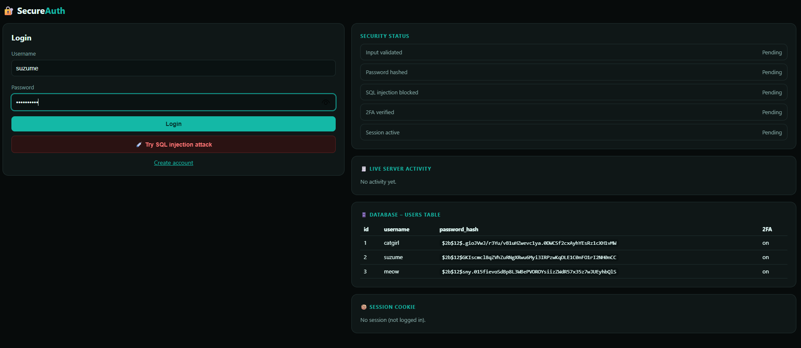
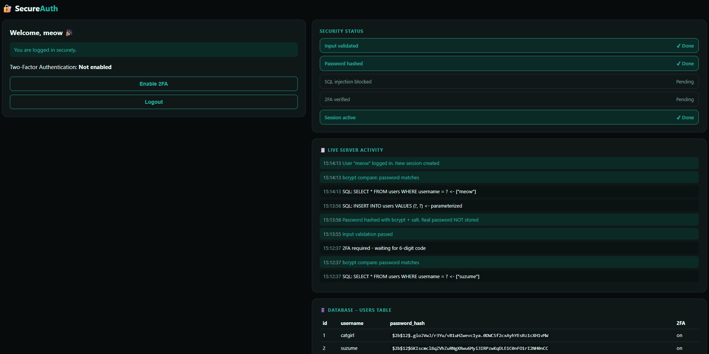
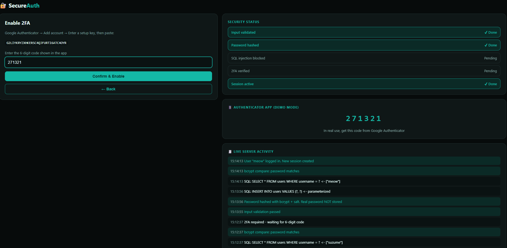
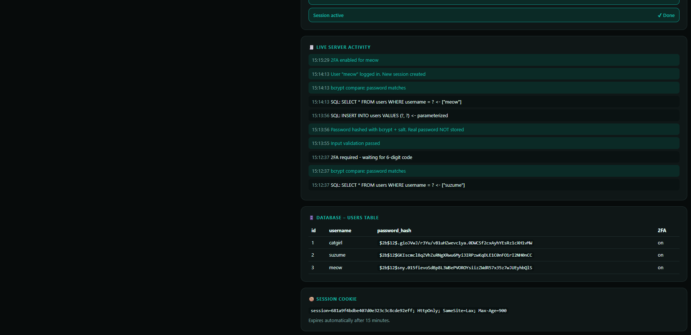

# 🔐 SecureAuth – Secure Login System

## 1. about project:

SecureAuth is a secure login web application built with **Python Flask**, **SQLite**, **bcrypt**, and **TOTP-based Two-Factor Authentication (2FA)**. It lets users register and log in safely, and protects their accounts from common attacks such as SQL injection, password theft, and session misuse.

The interface is split into two sides. The **left side** is the login and registration area. The **right side** shows a **live view of what the server is doing**: input validation, password hashing, session creation, 2FA status, and the database contents. This makes it easy to see how each security feature works in real time.

---

## 2. Features

- User registration and login with **hashed passwords** (bcrypt with salt)
- **Input validation** for usernames and passwords
- **SQL injection protection** using parameterized queries
- **Session management** with secure cookies, 15-minute auto-expiry, and logout
- **Two-Factor Authentication (2FA)** using TOTP, compatible with Google Authenticator
- **CSRF protection** on all forms
- Built-in **SQL injection test button** to show that the attack is blocked
- **Live security dashboard** with status, server activity log, database view, and session cookie

---

## 3. Working

**Registration**
1. The user enters a username and password.
2. The server validates the input (allowed characters, length, password strength).
3. The password is hashed using bcrypt with a random salt.
4. Only the hash is saved in the database using a parameterized INSERT query.

**Login**
1. The server validates the username format. Malicious input such as `' OR '1'='1` is rejected here.
2. The user is looked up using a parameterized SELECT query.
3. bcrypt compares the entered password with the stored hash.
4. If 2FA is enabled, the user must enter a valid 6-digit code.
5. A new session is created and a secure cookie is issued.
6. The user is redirected to the dashboard.

**Two-Factor Authentication**
1. On the dashboard, the user clicks **Enable 2FA**.
2. A secret key is generated and added to Google Authenticator.
3. The user confirms with a 6-digit code, and 2FA is switched on.
4. From then on, every login asks for a fresh 6-digit code after the password.

**Logout**
1. The session is completely destroyed on the server.
2. Opening the dashboard again redirects the user to the login page.

---

## 4. How the Security Works

| Threat | Protection used |
|---|---|
| Password theft from the database | Passwords are hashed with **bcrypt and salt**. Plain text is never stored. |
| SQL injection | **Parameterized queries** (`WHERE username = ?`) and server-side input validation |
| Weak or malformed input | Username: 3–20 letters, numbers, or underscore. Password: minimum 8 characters with a letter and a number. |
| Session hijacking and fixation | New session on every login, `HttpOnly` and `SameSite=Lax` cookie, 15-minute expiry, full session destroy on logout |
| Access with a stolen password | Optional **2FA** with a time-based 6-digit code |
| Cross-Site Request Forgery | CSRF token checked on every POST request |
| Username guessing | Same generic error message for a wrong username or a wrong password |

---

## 5. Tech Stack

| Layer | Technology |
|---|---|
| Backend | Python, Flask |
| Database | SQLite |
| Password hashing | bcrypt |
| Two-Factor Authentication | pyotp (TOTP) |
| Frontend | HTML and CSS (teal and black theme) |

---

## 6. Screenshots

### Login Page
The login form with the SQL injection test button. All security checks show as pending, and the database panel shows only hashed passwords.

### Successful Login and Dashboard
After login, the dashboard confirms a secure login. Input validation, password hashing, and session status are marked as done, and the live server activity log shows every step.

### Two-Factor Authentication Setup
The Enable 2FA page with the setup key and the 6-digit authenticator code.

### Session, Database and Server Activity
The live activity log, bcrypt hashed passwords in the database (`$2b$12$...`), and the secure session cookie with `HttpOnly`, `SameSite=Lax`, and a 15-minute expiry.

---

## 7. Learning Outcomes

- How password hashing and salting protect user credentials
- How SQL injection works and how parameterized queries prevent it
- Why server-side input validation is important
- How sessions, cookies, and session expiry work
- How TOTP-based Two-Factor Authentication adds a second layer of security
- How CSRF tokens protect forms from forged requests
